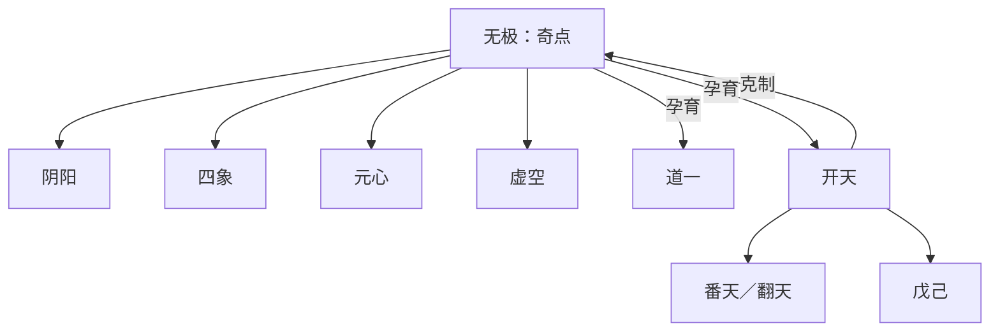

# 394章九印关系与八印到手：传承、显化、入门分开

1实际汲开天真意，2–8奇点光爆多宇宙是反馈内景；3孟法相与前世见识让其理解，13短刹关系明，外界非过去万年/全宇宙真毁。12九得八、17开天未入门受七激模糊幡，关系清楚不九种传承全收/全熟。

| 印 | 本章理解的来源/关联 | 当前边界 |
| --- | --- | --- |
| 无极 | 奇点无具体物；直接衍阴阳、四象、元心、虚空，孕道一、开天 | 最后缺印，未得 |
| 开天 | 脱胎无极且克无极；衍番天、戊己，象盘古幡 | 新真意已汲，明确未入门模糊相 |
| 道一 | 无双无对诸果之因；与无极之外七印千缕相联 | 灯照诸相沿旧皮毛，非新完整入门 |
| 阴阳 | 无极直接衍；与四象/虚空连通 | 已有传承/相，非本章新得 |
| 四象 | 无极直接衍；地力与戊己互演 | 完整反馈微征未修沿392 |
| 元心 | 无极直接衍，胸心试归最初 | 旧传承与应用，不新全悟 |
| 虚空 | 无极直接衍且由开天来，容阴阳四象 | 旧传承与应用，不无限逃 |
| 番天／翻天 | 开天力量衍，天健 | 同一印源异写，不新增第十印 |
| 戊己 | 开天承万物象地坤；与四象地相演 | 旧印入门，不实体旗新入库 |

图只示直接衍/孕与开天克无极，其他互联见表与原文，不画成无极已在孟手或道一由开天生。18盘古元始天王元始天尊别称是本文称谓说明、孟选熟名，不新真人降。30实体印发丝缠与16/17泥丸虚影各记，53齐带孟物逃、未本章向齐授两印。证据：v04-c0394:p0001–p0018、p0030、p0047–p0053。
